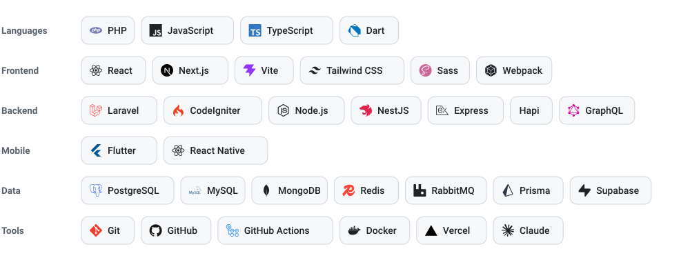
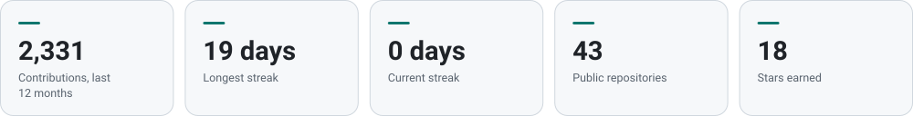
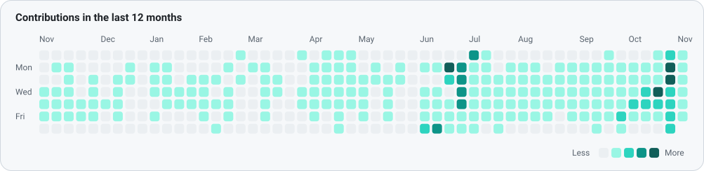

<div align="center">

<picture>
  <source media="(prefers-color-scheme: dark)" srcset="assets/hero-dark.svg">
  
</picture>

<br><br>

<a href="https://krishnahendra.site"></a>&nbsp;
<a href="https://www.linkedin.com/in/krishna-hendra-wijaya-80b713184/"></a>&nbsp;
<a href="https://www.instagram.com/krisnahendra_/"></a>&nbsp;
<a href="mailto:krisnahendrawijaya@gmail.com"></a>

</div>

<br>

## 👋 About me

I'm Krishna, a software developer from Malang, Indonesia. I build web, backend and mobile products, from Laravel systems for real businesses to Node.js APIs and Flutter apps. I work by one rule: **make it work, make it right, make it fast.**

```js
const krishna = {
  role: "Software Developer",
  basedIn: "Malang, East Java, Indonesia",
  education: "Bachelor's degree in Information Systems, Binus University",
  website: "https://krishnahendra.site",
  buildsWith: ["Laravel", "React", "Node.js", "Flutter"],
  askMeAbout: "https://github.com/KrishnaHendra/KrishnaHendra/issues",
};
```

## 🧰 Tech stack

<picture>
  <source media="(prefers-color-scheme: dark)" srcset="assets/tech-dark.svg">
  
</picture>

## 📊 GitHub activity

<picture>
  <source media="(prefers-color-scheme: dark)" srcset="assets/stats-dark.svg">
  
</picture>

<picture>
  <source media="(prefers-color-scheme: dark)" srcset="assets/activity-dark.svg">
  
</picture>

<details>
<summary>View these numbers as a table</summary>
<br>

<!-- stats:start -->

| Metric | Value |
|---|--:|
| Contributions, last 12 months | 2,414 |
| Longest streak | 19 days |
| Current streak | 3 days |
| Public repositories | 43 |
| Stars earned | 18 |

<!-- stats:end -->

</details>

<br>

<div align="center">


<sub>Stats refresh daily with GitHub Actions.</sub>

</div>
