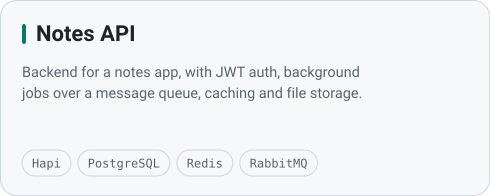
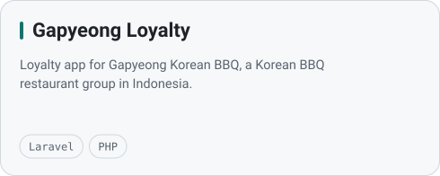
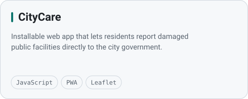
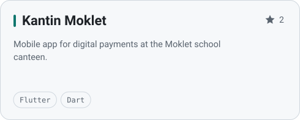
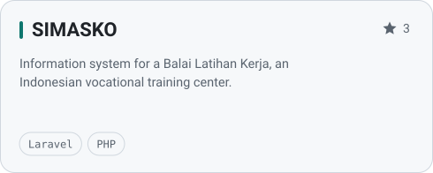
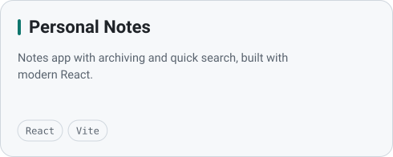
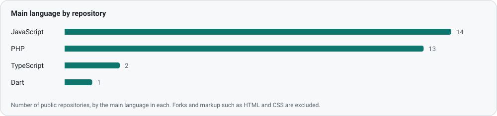

<div align="center">

<picture>
  <source media="(prefers-color-scheme: dark)" srcset="assets/hero-dark.svg">
  
</picture>

<br><br>

<a href="https://krishnahendra.site"></a>&nbsp;
<a href="https://www.linkedin.com/in/krishna-hendra-wijaya-80b713184/"></a>&nbsp;
<a href="https://www.instagram.com/krisnahendra_/"></a>&nbsp;
<a href="mailto:krisnahendrawijaya@gmail.com"></a>

</div>

<br>

## 👋 About me

I'm Krishna, a software developer from Malang, Indonesia. I build web, backend and mobile products, from Laravel systems for real businesses to Node.js APIs and Flutter apps. I work by one rule: **make it work, make it right, make it fast.**

```js
const krishna = {
  role: "Software Developer",
  basedIn: "Malang, East Java, Indonesia",
  education: "Bachelor's degree in Information Systems, Binus University",
  website: "https://krishnahendra.site",
  buildsWith: ["Laravel", "React", "Node.js", "Flutter"],
  askMeAbout: "https://github.com/KrishnaHendra/KrishnaHendra/issues",
};
```

## 🧰 Tech stack

<picture>
  <source media="(prefers-color-scheme: dark)" srcset="assets/tech-dark.svg">
  
</picture>

## 🚀 Featured projects

<a href="https://github.com/KrishnaHendra/notes-app"><picture><source media="(prefers-color-scheme: dark)" srcset="assets/project-notes-app-dark.svg"></picture></a>
<a href="https://github.com/KrishnaHendra/gapyeong-loyalty-app"><picture><source media="(prefers-color-scheme: dark)" srcset="assets/project-gapyeong-loyalty-app-dark.svg"></picture></a>
<a href="https://github.com/KrishnaHendra/citycareapp"><picture><source media="(prefers-color-scheme: dark)" srcset="assets/project-citycareapp-dark.svg"></picture></a>
<a href="https://github.com/KrishnaHendra/KamoFlutter"><picture><source media="(prefers-color-scheme: dark)" srcset="assets/project-KamoFlutter-dark.svg"></picture></a>
<a href="https://github.com/KrishnaHendra/simasko"><picture><source media="(prefers-color-scheme: dark)" srcset="assets/project-simasko-dark.svg"></picture></a>
<a href="https://github.com/KrishnaHendra/personal-notes-app"><picture><source media="(prefers-color-scheme: dark)" srcset="assets/project-personal-notes-app-dark.svg"></picture></a>

<!-- projects:start -->

<details>
<summary>See all 35 projects</summary>

| Project | About | Main language | Stars |
|---|---|---|--:|
| [documentation](https://github.com/KrishnaHendra/documentation) | - | MDX | 0 |
| [gapyeong-loyalty-app](https://github.com/KrishnaHendra/gapyeong-loyalty-app) | Gapyeong Korean BBQ Loyalty App | JavaScript | 0 |
| [personal-notes-app](https://github.com/KrishnaHendra/personal-notes-app) | Personal notes app with react | JavaScript | 0 |
| [docs](https://github.com/KrishnaHendra/docs) | - | MDX | 0 |
| [mintlify-docs](https://github.com/KrishnaHendra/mintlify-docs) | - | MDX | 0 |
| [StoryApp](https://github.com/KrishnaHendra/StoryApp) | A story-sharing application that allows users to share their moments and experiences through photos and stories. With Story App, users can capture and share their special moments with others. | JavaScript | 0 |
| [citycareapp](https://github.com/KrishnaHendra/citycareapp) | Aplikasi pelaporan kerusakan fasilitas umum yang mempermudah komunikasi langsung antara warga dan pemerintah kota. | JavaScript | 0 |
| [notes-app](https://github.com/KrishnaHendra/notes-app) | Notes App with Hapi | JavaScript | 0 |
| [rest-api-user](https://github.com/KrishnaHendra/rest-api-user) | - | TypeScript | 0 |
| [webhook-project](https://github.com/KrishnaHendra/webhook-project) | - | JavaScript | 0 |
| [Travel-Agent](https://github.com/KrishnaHendra/Travel-Agent) | Travel Agent Dynamic Landing Page | JavaScript | 2 |
| [website-project](https://github.com/KrishnaHendra/website-project) | - | JavaScript | 0 |
| [portfolio-tailwind](https://github.com/KrishnaHendra/portfolio-tailwind) | My Portfolio with Tailwind CSS | JavaScript | 0 |
| [notes-app-back-end](https://github.com/KrishnaHendra/notes-app-back-end) | - | JavaScript | 0 |
| [restaurant-app](https://github.com/KrishnaHendra/restaurant-app) | - | PHP | 2 |
| [simasko](https://github.com/KrishnaHendra/simasko) | Website Sistem Informasi Balai Latihan Kerja | PHP | 3 |
| [reporting-web](https://github.com/KrishnaHendra/reporting-web) | - | PHP | 1 |
| [KamoFlutter](https://github.com/KrishnaHendra/KamoFlutter) | - | Dart | 2 |
| [auth-laravel](https://github.com/KrishnaHendra/auth-laravel) | Laravel Authentication | PHP | 4 |
| [klinik-renceng-mose](https://github.com/KrishnaHendra/klinik-renceng-mose) | Klinik Renceng Mose Project | PHP | 1 |
| [sejayacorp](https://github.com/KrishnaHendra/sejayacorp) | Website Buy Ticket Event | PHP | 0 |
| [bullwhip](https://github.com/KrishnaHendra/bullwhip) | - | PHP | 0 |
| [bookshelf-app](https://github.com/KrishnaHendra/bookshelf-app) | - | JavaScript | 0 |
| [covid-info](https://github.com/KrishnaHendra/covid-info) | Refactor Mini Project Javascript to Typescript | TypeScript | 0 |
| [mini-project-node](https://github.com/KrishnaHendra/mini-project-node) | Mini Project Covid (Asmaraku) | JavaScript | 0 |
| [mini-project](https://github.com/KrishnaHendra/mini-project) | - | JavaScript | 0 |
| [Report](https://github.com/KrishnaHendra/Report) | - | PHP | 0 |
| [task-management](https://github.com/KrishnaHendra/task-management) | Aplikasi Task untuk mengelola task dan membantu menyelesaikan task untuk laporan dengan team | - | 0 |
| [tes_landa](https://github.com/KrishnaHendra/tes_landa) | - | PHP | 0 |
| [synchronizefull](https://github.com/KrishnaHendra/synchronizefull) | - | PHP | 0 |
| [synchronize-master](https://github.com/KrishnaHendra/synchronize-master) | - | JavaScript | 0 |
| [CodeIgniter-Toko](https://github.com/KrishnaHendra/CodeIgniter-Toko) | - | PHP | 0 |
| [CodeIgniter-Supplier](https://github.com/KrishnaHendra/CodeIgniter-Supplier) | - | - | 0 |
| [Laravel](https://github.com/KrishnaHendra/Laravel) | - | PHP | 0 |
| [fruit-store](https://github.com/KrishnaHendra/fruit-store) | - | PHP | 0 |

</details>

<!-- projects:end -->

## 📊 GitHub activity

<picture>
  <source media="(prefers-color-scheme: dark)" srcset="assets/stats-dark.svg">
  
</picture>

<picture>
  <source media="(prefers-color-scheme: dark)" srcset="assets/activity-dark.svg">
  
</picture>

<picture>
  <source media="(prefers-color-scheme: dark)" srcset="assets/languages-dark.svg">
  
</picture>

<details>
<summary>View these numbers as a table</summary>
<br>

<!-- stats:start -->

| Metric | Value |
|---|--:|
| Contributions, last 12 months | 2,295 |
| Longest streak | 19 days |
| Current streak | 13 days |
| Public repositories | 43 |
| Stars earned | 18 |
| Repositories in JavaScript | 14 |
| Repositories in PHP | 13 |
| Repositories in TypeScript | 2 |
| Repositories in Dart | 1 |

<!-- stats:end -->

</details>

<br>

<div align="center">


<sub>Stats refresh daily with GitHub Actions.</sub>

</div>
